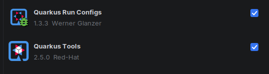
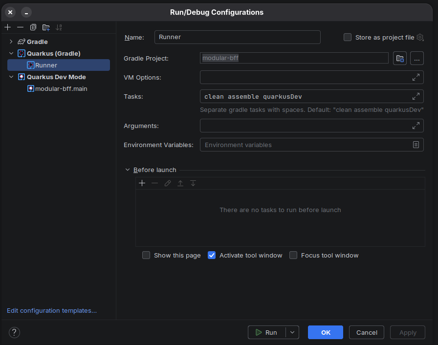

# Modular BFF (Quarkus & Kotlin)

Este projeto é um **Backend For Frontend (BFF) Modular** desenvolvido com o framework **Quarkus** e a linguagem **Kotlin**. Ele foi projetado seguindo os princípios da **Arquitetura Hexagonal (Ports & Adapters)**, garantindo um alto nível de desacoplamento entre a lógica de negócio e as tecnologias externas.

## 📝 Resumo do Projeto

O sistema atua como um agregador de serviços para o front-end, gerenciando diversos domínios de negócio de forma modularizado. A arquitetura está dividida em:

*   **Domínio ([src/main/kotlin/org/acme/domain](src/main/kotlin/org/acme/domain)):** Contém as entidades de negócio e regras puras.
*   **Adaptadores de API ([src/main/kotlin/org/acme/adapters/api](src/main/kotlin/org/acme/adapters/api)):** Implementações de entrada (REST Controllers).
*   **Adaptadores de Infraestrutura ([src/main/kotlin/org/acme/adapters/infrastructure](src/main/kotlin/org/acme/adapters/infrastructure)):** Implementações de saída como persistência com Hibernate/PostgreSQL.
*   **Configuração ([src/main/kotlin/org/acme/config](src/main/kotlin/org/acme/config)):** Configurações globais e provedores.

## 🛠 Dependências Necessárias

Para rodar o projeto localmente, você precisará das seguintes ferramentas:

*   **Java 21:** JDK recomendado para compatibilidade com as configurações do Gradle.
*   **Kotlin:** Linguagem principal do projeto.
*   **Go (Golang):** Necessário para instalar e rodar a ferramenta Goose.
*   **Docker & Docker Compose:** Necessário para subir o banco de dados PostgreSQL em container.
*   **Goose:** Ferramenta de migração de banco de dados SQL (instalada via Go; Comando presente no makefile do projeto).
*   **GNU Make:** Para execução simplificada de tarefas via [Makefile](Makefile).
*   **Gerenciador de Pacotes:** (Veja as instruções por SO abaixo).
*   **PostgreSQL** _(opcional)_**:** Durante o desenvolvimento do projeto, o banco de dados foi executado via container Docker (gerenciado pelo `make docker/up`). A instalação nativa é opcional e só necessária caso prefira rodar o PostgreSQL diretamente na máquina.

---

## 💻 Configuração por Sistema Operacional (Nativa)

### 🪟 Windows 
Recomendo utilizar o **Chocolatey** como gerenciador de pacotes no Windows para instalar as ferramentas:
1. Instale o [Chocolatey](https://chocolatey.org/install).
2. No PowerShell (como Admin), execute:
   ```powershell
   choco install make golang openjdk21 docker-desktop
   ```
3. O `Makefile` do projeto detecta automaticamente o ambiente Windows e utilizará o `gradlew.bat`.

### 🍎 macOS
Utilize o **Homebrew** para configurar o ambiente:
1. Instale o [Homebrew](https://brew.sh/).
2. No terminal, execute:
   ```bash
   brew install make golang openjdk@21 docker
   ```

### 🐧 Linux
Utilize o gerenciador de pacotes da sua distribuição:
*   **Ubuntu/Debian:** `sudo apt install make golang openjdk-21-jdk docker-compose`
*   **Fedora:** `sudo dnf install make golang java-21-openjdk docker-compose`
*   **Arch Linux:** `sudo pacman -S make go jdk21-openjdk docker-compose`

---

## 🚀 Comandos Principais (Makefile)

O projeto utiliza um [Makefile](Makefile) para padronizar as tarefas comuns.

### Dependências

| Comando | Descrição |
| :--- | :--- |
| `make deps/install` | Instala as dependências do Kotlin (Gradle) e a ferramenta Goose. |
| `make deps/up` | Sobe o Docker, aguarda o DB e aplica as migrações. |
| `make deps/up/populated` | Sobe a infra e popula o banco com dados de teste ([seed.sql](config/database/test-data/seed.sql)). |
| `make deps/down` | Encerra e remove os containers da infraestrutura. |
| `make deps/restart` | Reinicia toda a infraestrutura (com migrações aplicadas). |
| `make deps/restart/populated` | Reinicia toda a infraestrutura com dados de [seed](config/database/test-data/seed.sql). |

### Desenvolvimento

| Comando | Descrição |
| :--- | :--- |
| `make dev` | Inicia o Quarkus em modo de desenvolvimento (Live Coding). |
| `make build` | Compila e empacota a aplicação via Gradle. |
| `make test` | Reinicia a infraestrutura e executa todos os testes automatizados. |
| `make lint` | Executa o KtLint para verificar o estilo do código. |
| `make detekt` | Executa o Detekt para análise estática do código. |

### Docker — Infraestrutura

| Comando | Descrição |
| :--- | :--- |
| `make docker/up` | Sobe os containers de infraestrutura (banco de dados, etc.) em modo detached. |
| `make docker/down` | Para e remove os containers de infraestrutura. |

### Docker — Build da Aplicação

A aplicação suporta três modos de build, controlados via `--build-arg`:

| Comando | Descrição |
| :--- | :--- |
| `make container/build` | Build da imagem Docker no modo padrão (external + internal ativos). |
| `make container/build/external` | Build da imagem Docker somente com a API externa ativa. |
| `make container/build/internal` | Build da imagem Docker somente com a API interna ativa. |

### Docker — Execução da Aplicação

| Comando | Descrição | Porta |
| :--- | :--- | :--- |
| `make container/run` | Executa o container no modo padrão. | `9000` |
| `make container/run/external` | Executa o container no modo externo. | `9001` |
| `make container/run/internal` | Executa o container no modo interno. | `9002` |

### Docker — Build + Execução (Atalhos)

| Comando | Descrição |
| :--- | :--- |
| `make app/build/run/default` | Faz o build e executa a aplicação no modo padrão. |
| `make app/build/run/external` | Faz o build e executa a aplicação no modo externo. |
| `make app/build/run/internal` | Faz o build e executa a aplicação no modo interno. |

---

## 🏗 Particularidades de IDE

### Visual Studio Code (VS Code)
*   **Extensões Recomendadas:** Instale o pack de extensões do `Quarkus`, `Kotlin` (da JetBrains) e `Docker`.
*   O projeto já contém configurações em [.vscode](.vscode) para facilitar o debug e execução de tasks.

### IntelliJ IDEA
*   Recomenda-se o uso do plugin oficial do **Quarkus** para suporte a autocompletar e navegação.
*   O suporte ao **Kotlin** e **Gradle** é nativo e altamente otimizado nesta IDE.
*   Baixe os plugings do quarkus:
   * 
*   Configure o runner da seguinte forma: 
   * 

---

## 📦 Empacotamento e Execução

O aplicativo pode ser empacotado usando:

```shell script
./gradlew build
```

Isso produz o arquivo `quarkus-run.jar` no diretório `build/quarkus-app/`.
A aplicação pode então ser executada com: `java -jar build/quarkus-app/quarkus-run.jar`.

Se você quiser criar um *über-jar*, execute:

```shell script
./gradlew build -Dquarkus.package.jar.type=uber-jar
```

---

## Criando um executável nativo

Você pode criar um executável nativo usando:

```shell script
./gradlew build -Dquarkus.native.enabled=true
```

Ou, se você não tiver o GraalVM instalado, você pode executar a compilação do executável nativo em um container usando:

```shell script
./gradlew build -Dquarkus.native.enabled=true -Dquarkus.native.container-build=true
```

Você pode então executar seu executável nativo com: `./build/modular-bff-1.0.0-SNAPSHOT-runner`

Se você quiser saber mais sobre como criar executáveis nativos, consulte <https://quarkus.io/guides/gradle-tooling>.

## Guias Relacionados

- REST ([guia](https://quarkus.io/guides/rest)): Uma implementação Jakarta REST utilizando processamento em tempo de compilação e Vert.x. Esta extensão não é compatível com a extensão quarkus-resteasy, ou qualquer uma das extensões que dependam dela.

## Código Fornecido

### REST

Inicie facilmente seus Web Services REST

[Seção do guia relacionado...](https://quarkus.io/guides/getting-started-reactive#reactive-jax-rs-resources)
